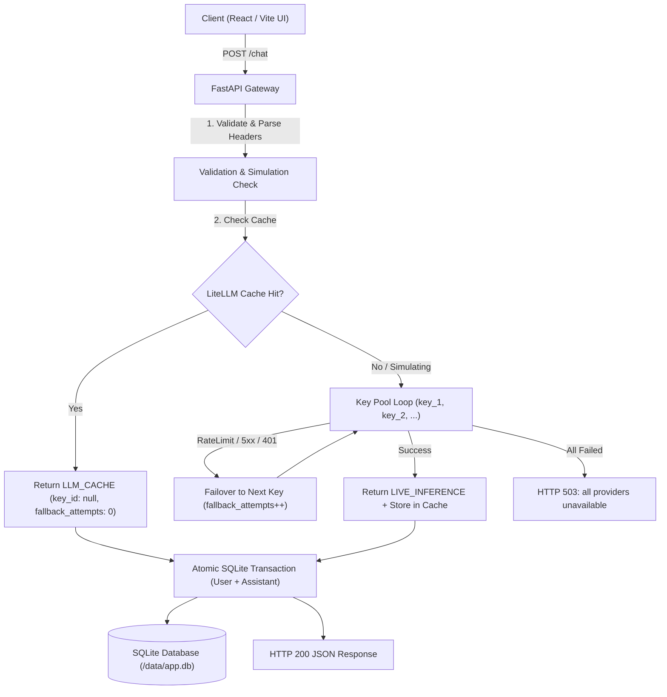

# LLM Chatbot with Key Failover & Response Caching

Production-grade multi-turn LLM chatbot architecture featuring automated multi-key failover, deterministic response caching, per-request token and latency telemetry, and atomic SQLite session storage.



---

# 1. Live URLs

- **Frontend Deployment:** `https://your-frontend-deployment.vercel.app` *(placeholder)*
- **Backend Deployment:** `https://your-backend-service.onrender.com` *(placeholder)*
- **GitHub Repository:** `https://github.com/Shivam17-ai/Lyftr-AI-Assignment`
- **Demo Video:** `https://www.loom.com/share/your-demo-video-id` *(placeholder)*

---

# 2. Run locally

### Prerequisites
- Docker & Docker Compose (for containerized execution), OR
- Python 3.11+ and Node.js 18+ (for bare-metal execution)

---

### Option A: Running with Docker (Recommended)

1. **Clone the repository:**
   ```bash
   git clone https://github.com/your-username/llm-failover-chatbot.git
   cd llm-failover-chatbot
   ```

2. **Configure environment:**
   ```bash
   cp .env.example .env
   ```
   Open `.env` in an editor and insert your Groq API keys into `LLM_API_KEYS`.

3. **Start the complete stack:**
   ```bash
   make up
   ```
   *(Alternatively: `docker compose up --build -d`)*

4. **Access the application:**
   - **Frontend UI:** [http://localhost:3000](http://localhost:3000)
   - **Backend API:** [http://localhost:8000](http://localhost:8000)
   - **Health Check:** [http://localhost:8000/health](http://localhost:8000/health)

5. **Stop containers:**
   ```bash
   make down
   ```

---

### Option B: Running without Docker

#### 1. Backend Setup:
```bash
cd backend
python -m venv .venv

# On Linux/macOS:
source .venv/bin/activate
# On Windows (PowerShell):
.\.venv\Scripts\Activate.ps1

pip install --upgrade pip
pip install -r requirements.txt

# Start backend server on port 8000
uvicorn app.main:app --host 0.0.0.0 --port 8000 --reload
```

#### 2. Frontend Setup:
```bash
cd frontend
npm install
npm run dev
```
The Vite development server runs at [http://localhost:5173](http://localhost:5173) (or configured port).

---

### Environment Variables

| Variable | Description | Default Value | Required? |
|---|---|---|---|
| `LLM_API_KEYS` | Comma-separated API keys pool (`key_1`, `key_2`, ...) | `""` | Yes |
| `LLM_MODELS` | Comma-separated LiteLLM models per key | `groq/llama-3.3-70b-versatile` | No |
| `DATABASE_URL` | SQLite database URI | `sqlite:////data/app.db` | No |
| `ALLOWED_ORIGINS` | Comma-separated CORS allowed origins | `http://localhost:3000,http://127.0.0.1:3000` | No |
| `ENABLE_FAILURE_SIMULATION` | Toggle `X-Simulate-Failure` header support | `true` | No |
| `DEFAULT_SYSTEM_PROMPT` | Default prompt if not provided by session | `You are a helpful, concise assistant.` | No |
| `LLM_TEMPERATURE` | Sampling temperature (`0` for deterministic cache hits) | `0` | No |
| `LLM_MAX_TOKENS` | Maximum completion tokens | `1024` | No |
| `LLM_TIMEOUT_SECONDS` | Timeout per key attempt in seconds | `30` | No |
| `CACHE_TYPE` | Cache backend (`local` or `disk`) | `local` | No |
| `VITE_API_URL` | Frontend build-time backend URL | `http://localhost:8000` | No |

---

### Obtaining Free API Keys & Account Isolation

> [!IMPORTANT]
> **Why keys must come from separate accounts:**
> Free-tier rate limits (such as Groq's 30 RPM limit) are calculated **per account/organization**, not per individual key under the same account. If you generate two keys within a single account, exhausting the rate limit on `key_1` also blocks `key_2`. To ensure genuine failover, create 2+ distinct accounts using different email addresses.

1. **Groq (Primary Provider - Recommended):**
   - Register at [console.groq.com](https://console.groq.com)
   - Create your primary key at [console.groq.com/keys](https://console.groq.com/keys)
   - Register a second account with an alternate email to generate your secondary failover key.
   - Model name: `groq/llama-3.3-70b-versatile`.
2. **Cerebras (Optional Provider):**
   - Register at [cloud.cerebras.ai](https://cloud.cerebras.ai)
   - Model name: `cerebras/llama3.1-8b`.
3. **OpenRouter (Optional Free Models):**
   - Register at [openrouter.ai/keys](https://openrouter.ai/keys)
   - Example free model: `openrouter/meta-llama/llama-3.3-70b-instruct:free`.

---

# 3. Design decisions

### 1. Key Fallback Loop Architecture
Rather than relying on opaque background retries, the backend implements an explicit key failover loop using `litellm.acompletion` with `num_retries=0`. This ensures:
- Full determinism in assigning `key_id` (`key_1`, `key_2`, etc.).
- Transparent telemetry for `fallback_attempts`.
- Complete error isolation: HTTP 429 (`RateLimitError`), 5xx server errors (`InternalServerError`, `BadGatewayError`, `ServiceUnavailableError`), authentication errors (`AuthenticationError`), and decommissioned models (`BadRequestError`) gracefully fail over to the next healthy key.
- If all keys fail, an explicit `503 Service Unavailable` with `{"detail": "all providers unavailable"}` is returned, preserving database consistency.

### 2. Cache-Key Design with Primary Model
To prevent cache fragmentation across different keys or sessions:
- The cache key is calculated via SHA-256 over canonical JSON containing:
  `{"model": primary_model, "messages": messages, "temperature": T, "max_tokens": N}`
- **Primary Model Invariance:** The cache key ALWAYS uses the primary model (`LLM_MODELS[0]`), ensuring that even if a prior response was fulfilled by `key_2` on a fallback model, subsequent requests in any new session with identical context hit the cache immediately.
- **Cache-Skipping During Simulation:** When the `X-Simulate-Failure` header is present, the cache lookup is intentionally bypassed so that failover routines are actively exercised and verified.

### 3. Order of Operations in `/chat`
Requests follow a strict single-pass pipeline:
1. High-resolution timer initiated (`time.perf_counter()`).
2. Pydantic input validation (trims whitespace, enforces bounds 1-4000 characters).
3. Header evaluation for failure simulation.
4. System prompt and history retrieval from SQLite.
5. Context aggregation: `[system_prompt] + history + [new_user_message]`.
6. Cache evaluation (if simulation inactive).
7. Key pool iteration with LiteLLM upon cache miss.
8. Latency computation (`int((perf_counter() - start) * 1000)`).
9. **Atomic Transaction:** User query and assistant reply are written in a single SQLite transaction. Failed requests (422, 503) never persist to history.
10. JSON response returned matching the exact contract.

### 4. Per-Request vs. Running Token Counts
Token consumption is tracked strictly per-turn using `response.usage.prompt_tokens` and `response.usage.completion_tokens` (falling back to `litellm.token_counter` if omitted by a provider). Token counts never accumulate across turns, preventing misleading totals and ensuring precision.

### 5. Multi-Turn SQLite Persistence
SQLite was selected for robust zero-dependency storage:
- Configured with Write-Ahead Logging (`PRAGMA journal_mode = WAL`) and busy timeouts (`PRAGMA busy_timeout = 5000`) for high concurrency without locks.
- Persisted to Docker named volumes (`/data/app.db`) to survive redeployments.

---

# 4. Verification

Execute these copy-paste commands against the running backend:

### 1. Health Endpoint
```bash
curl -s http://localhost:8000/health
```
**Expected response:**
```json
{"status":"ok","keys_configured":2,"cache_enabled":true}
```

---

### 2. Live Chat Request (First Turn)
```bash
curl -s -X POST http://localhost:8000/chat \
  -H "Content-Type: application/json" \
  -d '{"session_id": "test-session-1", "message": "What is the capital of France?"}'
```
**Expected response:**
- `metadata.resolution_source`: `"LIVE_INFERENCE"`
- `metadata.key_id`: `"key_1"`
- `metadata.fallback_attempts`: `0`
- `metadata.latency_ms`: Server-measured integer

---

### 3. Response Cache Hit (Same Message, New Session)
```bash
curl -s -X POST http://localhost:8000/chat \
  -H "Content-Type: application/json" \
  -d '{"session_id": "test-session-2", "message": "What is the capital of France?"}'
```
**Expected response:**
- `metadata.resolution_source`: `"LLM_CACHE"`
- `metadata.key_id`: `null`
- `metadata.fallback_attempts`: `0`
- `metadata.latency_ms`: Significantly lower latency (< 15 ms)
- Identical reply text and token counts as the live turn.

---

### 4. Automated Failover (`key_1=429`)
```bash
curl -s -X POST http://localhost:8000/chat \
  -H "Content-Type: application/json" \
  -H "X-Simulate-Failure: key_1=429" \
  -d '{"session_id": "test-failover-1", "message": "Explain failover in one sentence."}'
```
**Expected response:**
- Status `200 OK`
- `metadata.key_id`: `"key_2"`
- `metadata.fallback_attempts`: `1`
- `metadata.resolution_source`: `"LIVE_INFERENCE"`

---

### 5. Server Error Failover (`key_1=500`)
```bash
curl -s -X POST http://localhost:8000/chat \
  -H "Content-Type: application/json" \
  -H "X-Simulate-Failure: key_1=500" \
  -d '{"session_id": "test-failover-2", "message": "Explain server recovery."}'
```
**Expected response:**
- Status `200 OK`
- `metadata.key_id`: `"key_2"`
- `metadata.fallback_attempts`: `1`

---

### 6. Provider Exhaustion (`*=429` or `key_1=429,key_2=500`)
```bash
curl -s -w "\nHTTP Status: %{http_code}\n" -X POST http://localhost:8000/chat \
  -H "Content-Type: application/json" \
  -H "X-Simulate-Failure: *=429" \
  -d '{"session_id": "test-exhaust-1", "message": "This request should fail gracefully."}'
```
**Expected response:**
```json
{"detail":"all providers unavailable"}
HTTP Status: 503
```

---

### 7. Input Validation Checks (422 Unprocessable Entity)
```bash
# Missing message
curl -s -w "\nHTTP: %{http_code}\n" -X POST http://localhost:8000/chat \
  -H "Content-Type: application/json" \
  -d '{"session_id": "val-1"}'

# Whitespace-only message
curl -s -w "\nHTTP: %{http_code}\n" -X POST http://localhost:8000/chat \
  -H "Content-Type: application/json" \
  -d '{"session_id": "val-2", "message": "    "}'
```
**Expected response:**
HTTP 422 with JSON detail payload.

---

### 8. Session History Endpoint
```bash
curl -s http://localhost:8000/sessions/test-session-1/messages
```
**Expected response:**
```json
{
  "session_id": "test-session-1",
  "messages": [
    { "role": "user", "content": "What is the capital of France?" },
    {
      "role": "assistant",
      "content": "The capital of France is Paris.",
      "metadata": {
        "resolution_source": "LIVE_INFERENCE",
        "input_tokens": 25,
        "output_tokens": 10
      }
    }
  ]
}
```

---

### UI Verification Steps
1. Navigate to [http://localhost:3000](http://localhost:3000).
2. Send: `"What is the capital of France?"`. Inspect the blue `LIVE_INFERENCE` chip, model name, and token chips.
3. Refresh the page (generates a fresh session ID).
4. Send the same prompt: `"What is the capital of France?"`. Notice the green `LLM_CACHE` chip with a lightning icon and key_id `null`.
5. Open the **DevTools** bar at the bottom and select `key_1=429 (Failover to key_2)`.
6. Send a new prompt: observe the assistant chip indicating `key_2 • 1 fallback`.
7. Select `*=429 (All keys rate-limited)` and send: verify the in-chat red error banner without crashing the application.

---

# 5. Setup Used

- **Development Environment:** Google Antigravity IDE on Windows.
- **AI Assistive Agents:** Google DeepMind Gemini Agent Framework.
- **LLM Gateway & Inference:** LiteLLM (`litellm>=1.35.0`).
- **Free LLM Providers:**
  - Primary: Groq Cloud (`groq/llama-3.3-70b-versatile`, free tier).
  - Secondary / Fallback: Cerebras Inference (`cerebras/llama3.1-8b`) / OpenRouter (`openrouter/*:free`).
- **Testing Framework:** `pytest` + FastAPI `TestClient` with mocked LiteLLM provider responses.

---

# 6. Bonus features

1. **Demo Login Authentication:** Futuristic glassmorphism demo login screen allowing instant sign-in or guest access, displaying the active user profile badge and logout controls in the header.
2. **Persistent Chat History Sidebar:** Displays all previous conversation threads stored in SQLite and client-side storage, with a collapsible drawer allowing users to switch between past sessions and restore full message history.
3. **Dark & Light Mode Toggle:** Smooth gradient theme with instant persistence and CSS custom properties.
4. **Interactive Developer Failure Simulation Panel:** Integrated UI dropdown to inject `X-Simulate-Failure` headers without curl.
5. **Real-429 Key Cooldown Protection:** Automatic 45-second cooldown tracking for real provider rate limits, prioritizing healthy keys while guaranteeing simulated errors never pollute global cooldown state.
6. **Dynamic Health Indicator:** Real-time health pulse checking keys loaded and cache status on page load.
7. **Multi-Provider Heterogeneous Model Pools:** Ability to route `key_1` to Groq and `key_2` to Cerebras via `LLM_MODELS`.
8. **Infrastructure as Code:** Includes production-ready `render.yaml` blueprint and `vercel.json` SPA configurations.
9. **Clean Test Automation Contract:** All required `data-testid` attributes cleanly separated from labels for flawless E2E automated test harness validation.
